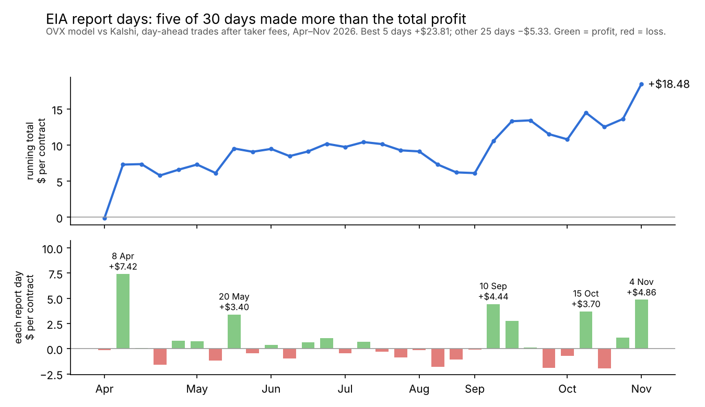

# Kalshi oil contracts vs the options market


**Question:** Kalshi lists daily (`KXWTI`) and weekly (`KXWTIW`) contracts on where WTI crude settles. A
full set of strikes is a bet on volatility: the market prices a spread of outcomes. Is that spread
wider or narrower than the oil options market (OVX) says it should be? Where is the gap largest: the
middle, the tails, or EIA report days? And is any of it tradeable after Kalshi's fees and spread?

This is a volatility study, not a directional one. The model takes its **centre** from WTI futures and
its **width** from OVX, so Kalshi prices are never used to price Kalshi.

## Results: one year, 219 Kalshi WTI events (Nov 2025 to Nov 2026)

- **Width.** A day before settle, Kalshi priced about 15% less volatility than OVX (median ratio 0.85).
  Six hours before settle it priced about 7% more (1.07). Day-ahead, Kalshi's narrower width was closer to
  the moves that actually came.
- **Accuracy.** Kalshi's mid prices were as accurate as the OVX model (Brier 0.0694 vs 0.0697 over 8,659
  contracts) and well calibrated above 5 cents. On ordinary days, trading against Kalshi made -0.4c per
  contract after fees: no edge.
- **EIA report days.** Trading the OVX model against Kalshi made **+7.8c per contract after fees** over 30
  report days (t = 1.5). It falls to +4.9c without the best day and +3.0c (t = 0.7) without the best two,
  so it is promising but not yet proven.
- **Report-day moves.** Not clearly larger than other days once one overnight news shock (8 April) is
  removed (ratio 1.06), and Kalshi priced report days no differently (0.99).



**Live forward test.** Since 10 November 2026 the model's prices for every open contract are committed to
[`forward_log/`](forward_log) each weekday, about 7 hours before the 2:30 pm New York settle. The commit
timestamps show each prediction was made before its outcome. Scored with `score_forward.py`.

## Files

| File | What it does |
|---|---|
| `download.py` | Pulls settled Kalshi WTI markets, hourly bid/ask, OVX and WTI from FRED, optional CL=F hourly |
| `analyse.py` | Builds snapshots and answers Q1 (width), Q2 (accuracy), Q3 (edge after fees) |
| `forward_log.py` | **Run every weekday.** Logs model prices *before* settlement, for a timestamped track record |
| `daily.ps1` | Windows: the whole daily routine in one command (`.\daily.ps1`) |
| `schedule_daily.ps1` | Windows, one-time: runs `daily.ps1` automatically every weekday at 1:20 pm |
| `score_forward.py` | Scores the forward log once contracts settle |
| `wednesday_check.py` | Realised vs Kalshi-priced vs OVX volatility by settle weekday (the EIA-Wednesday test) |
| `make_demo_data.py` | Synthetic data with planted flaws, so you can run everything offline |
| `oilvol/model.py` | Lognormal contract pricing, implied centre/width fit, Kalshi fee formula, scores |
| `oilvol/dataset.py` | Snapshots, trading-time clock (CME Globex hours) |
| `oilvol/kalshi.py` | Public API client (live + historical archive), no key needed |
| `oilvol/fred.py`, `oilvol/futures.py` | OVX, WTI spot, realised vol; optional CL=F futures centre |
| `tests/` | Unit tests plus an offline end-to-end test with a fake API |

## Setup (10 minutes)

```bash
python -m venv .venv && source .venv/bin/activate   # Windows: .venv\Scripts\activate
pip install -r requirements.txt
pip install yfinance          # optional but recommended: independent futures centre
python -m pytest -q           # should say: 13 passed
```

## Step 0: run the demo first (no internet needed)

```bash
python make_demo_data.py
python analyse.py --data data_demo --out outputs_demo
```

The synthetic market prices outcomes 15% wider than true volatility. Wednesdays are 40% more volatile,
which the market knows and OVX doesn't. Longshots are marked up by 1.5 cents. The analysis finds all three:
- Kalshi-implied width is about 1.2x OVX, rising to about 1.45x on Wednesdays.
- The OVX model **loses** money on Wednesdays, because there the market is right.
- It makes a small, statistically weak profit on other days.

That's the kind of honest, specific finding you're aiming for with the real data.

## Step 1: real data

```bash
python download.py --since 2026-05-01     # ~1 API call per contract; 6 months takes 15-30 min
python analyse.py                          # writes outputs/summary.md and charts
```
Before trusting results, check:
- The series fee settings that `download.py` prints. Fees here assume the general schedule: taker
  `round_up(0.07 x C x P x (1-P))`, makers free.
- How early contracts open. If 24h snapshots are missing, pass `--hours-before 12 6 --trade-hours 12`.

## Step 1b: the Wednesday check

```bash
python wednesday_check.py                 # needs outputs/snapshots.csv from analyse.py
```
Measures how much WTI futures actually moved before each settle and compares that with what
Kalshi priced and what OVX implied, split by weekday and by EIA report day (Wednesday, or Thursday in
holiday weeks - see `oilvol/eia.py`). If report days move much more but Kalshi
prices them about the same as other days, that supports the EIA-day finding directly.

## Step 2: forward test (start this in week 1 and never skip a day)

On Windows the whole routine is one command, run from the project folder: `.\daily.ps1`. It switches on
the environment, logs, commits, pulls any updates and pushes (and on Fridays also runs `score_forward.py`).
The manual steps are:

```bash
python forward_log.py                     # ~2:30 pm Lagos: 6h before the 2:30 pm ET settle (8:30 pm Lagos Nov-Mar)
git add forward_log && git commit -m "forward log" && git push
python score_forward.py                   # weekly
```
The git commit time proves each forecast came before the result. After 4-6 weeks this is a
real out-of-sample record, which is exactly what Moreton's Alpha Signal Program asks for.

## Method in brief

- **Contract value.** Settle S is lognormal: P(S > K) = N(d2), with d2 = [ln(F/K) - sigma^2 tau/2] / (sigma sqrt(tau)).
  Ranges and tails use half-cent edges, so a full set adds up to exactly 1 (tested).
- **Time** tau counts only hours when CME Globex crude is open (about 23 hours a day, 252 days a year). Weekends don't count.
- **Kalshi-implied width.** Fit (F, sigma) to mid prices, using only contracts priced 3c-97c with spreads
  of 10c or less, weighted by 1/spread. Contracts stuck on the 1-2c tick floor are excluded because they bias the fit.
- **Model.**
  - Centre: the CL=F futures price at the snapshot. If yfinance isn't installed, Kalshi's fitted centre is used instead.
  - Width: the previous day's OVX close (no look-ahead). A realised-vol (EWMA) version is the benchmark.
- **Scoring.** Brier score on settled outcomes, all models on the same contracts. The backtest trades at the
  bid or ask with taker fees, and t-stats are computed across events, not trades.

## Limitations

- OVX is 30-day implied vol on USO options, not a daily WTI option. A one-day horizon has its own term structure.
- Around each monthly roll, CL=F and Kalshi's "front month" can refer to different contracts. Flag those days.
- Near settlement, the $1 strike spacing is wider than the remaining uncertainty, so widths become noisy.
- Hourly candle bid/ask are quotes, not fills. Real size at the top of the book may be small.
- Contracts in one event share one outcome. A few dozen events is a small sample, whatever the trade count says.

## Further reading

- Kalshi API docs: https://docs.kalshi.com/getting_started
- Kalshi WTI contract terms: https://kalshi-public-docs.s3.amazonaws.com/contract_terms/WTIOIL.pdf
- Dune, "Self-calibrating commodity event contracts: WTI front-month settle": https://dune.com/blog/kalshi-wti-self-calibrating-event-contracts
- Bürgi, Deng & Whelan, "Makers and Takers: The Economics of the Kalshi Prediction Market": https://www.karlwhelan.com/Papers/Kalshi.pdf
